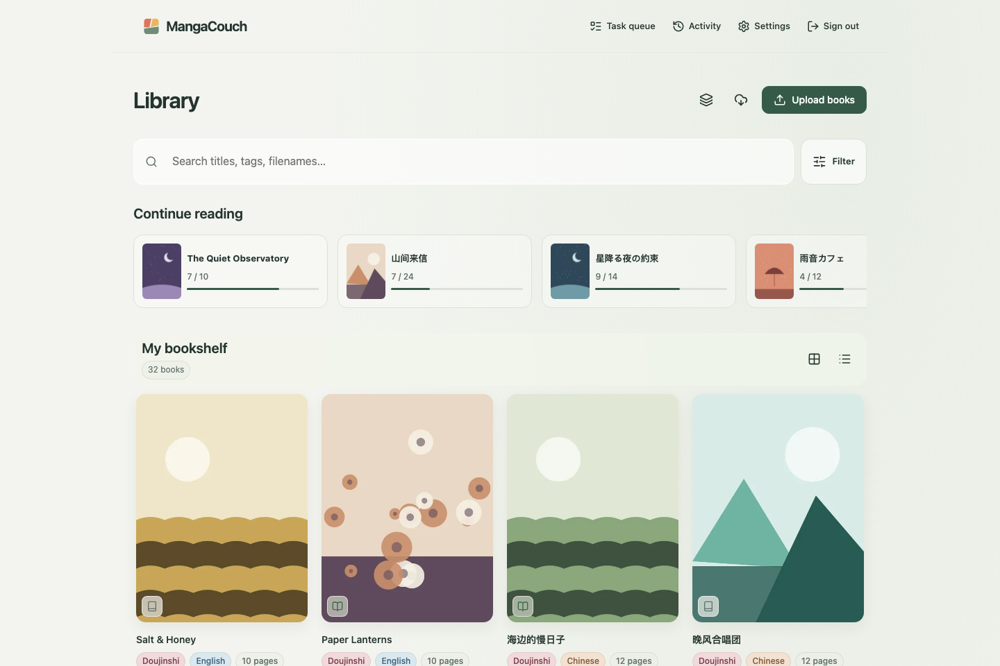
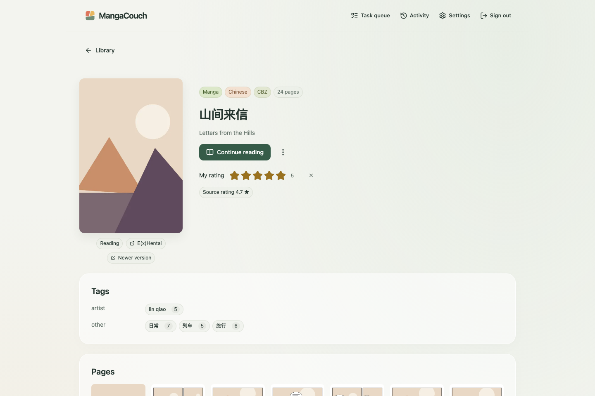
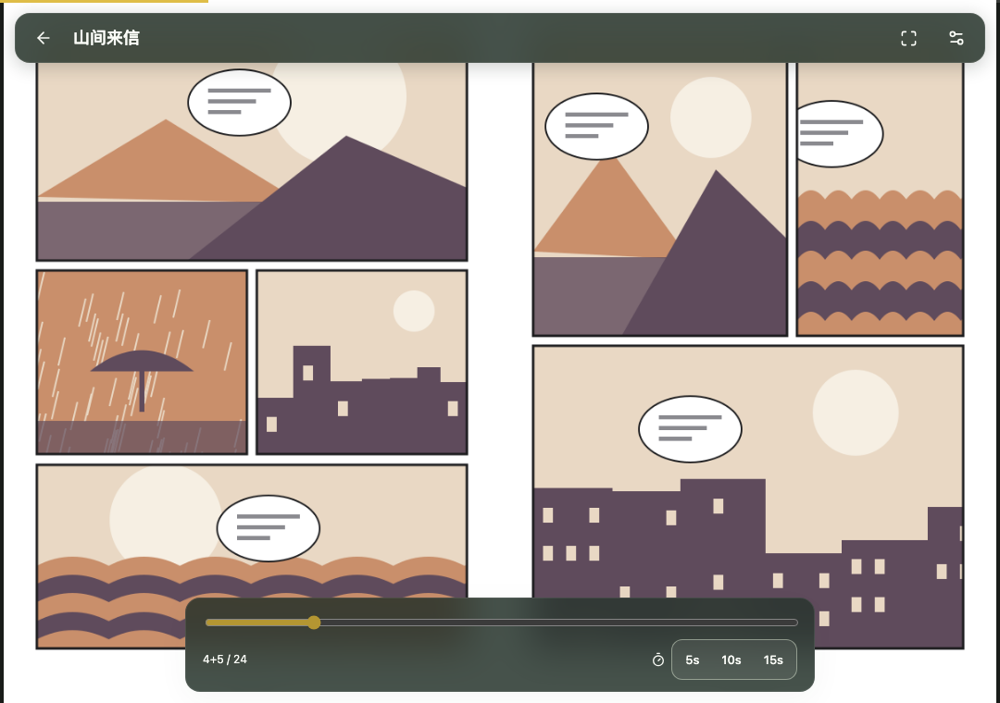
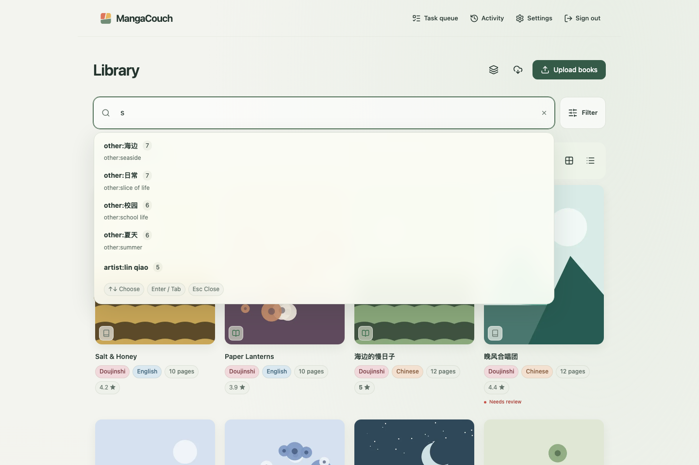
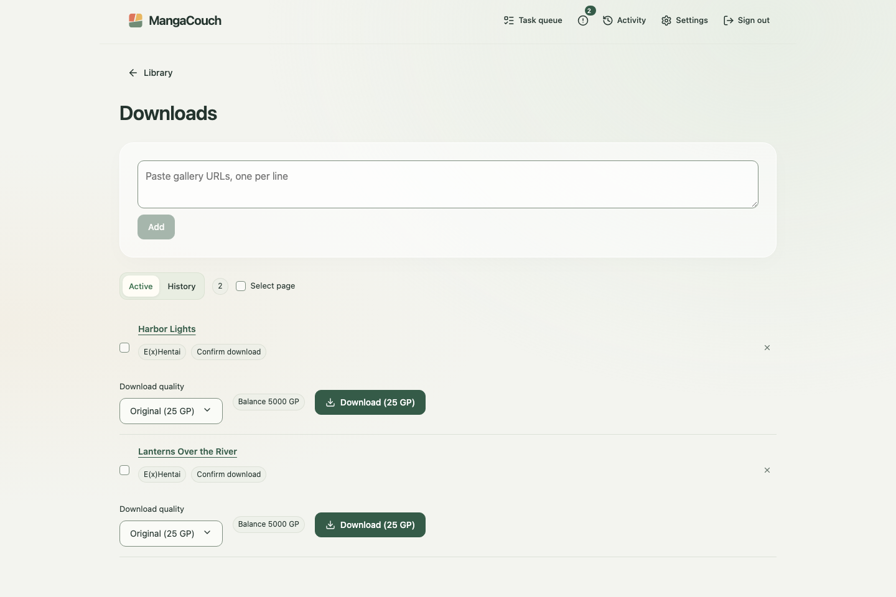
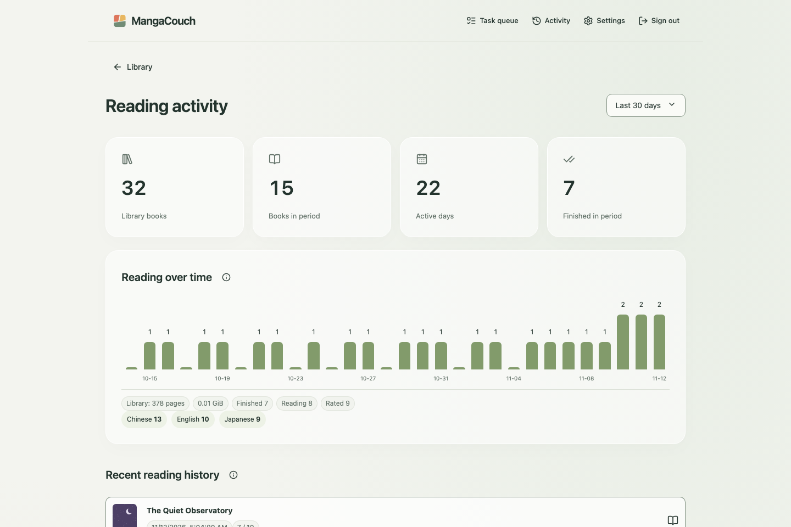
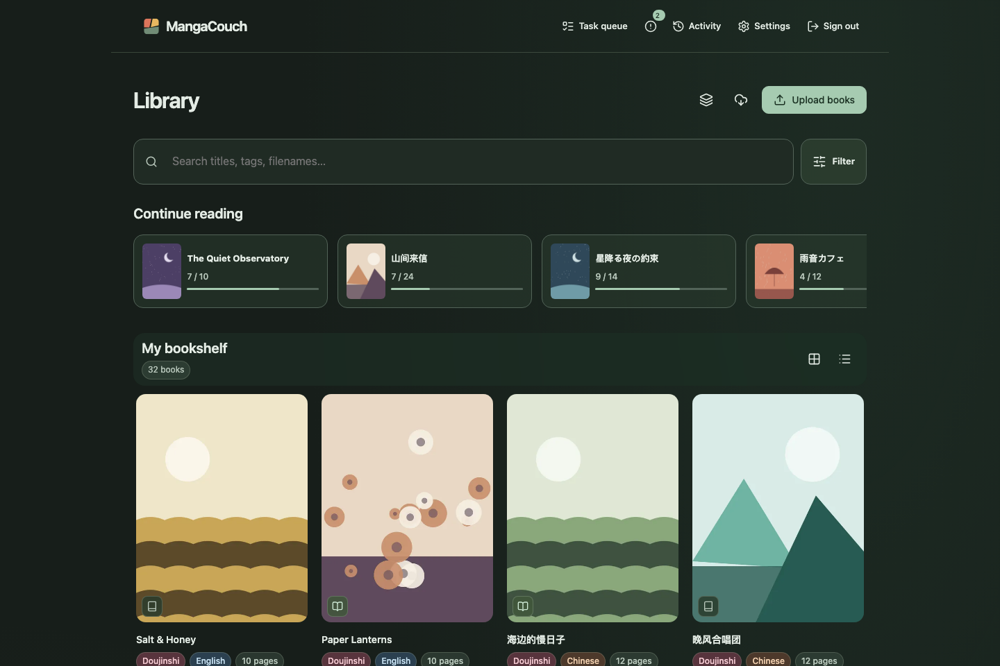
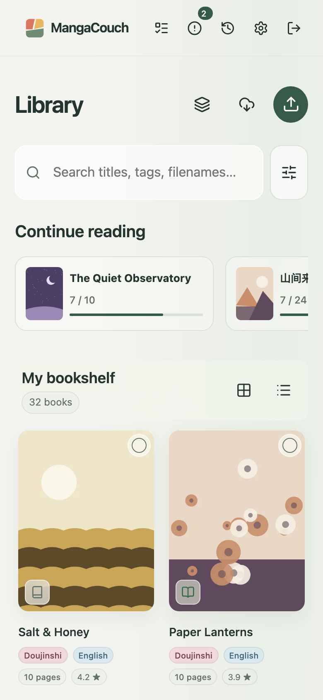

# MangaCouch

**English** | [简体中文](README.zh-CN.md)

A self-hosted comic library for one owner: import CBZ/ZIP and PDF files, read them in the browser on any device, and connect your favourite reader app over OPDS or a Komga-compatible API.



## Features

- **Library** — upload books or drop them in an `import/` folder; GIF, JPEG, WebP and PNG pages.
- **Find things** — tag autocomplete with Chinese tag translations; filters by category, language, source, reading status and rating; **Static** collections you fill by hand and **Dynamic** ones that follow a search.
- **Reader** — single page, two-page spread or vertical scroll, left-to-right or right-to-left, autoplay and a page-preview scrubber.
- **Synced** — progress and ratings follow you across devices; reading statistics show what you read and when.
- **Tidy metadata** — review queue, page-level duplicate detection with indexing and book-comparison progress and a `.mangacouch.json` sidecar next to every book.
- **Downloads** — queue E(x)Hentai galleries from the web app or the Chrome extension, choose download quality, and approve paid archives before they are bought. E-Hentai requests stay within a model of the site's usage limit and pause by themselves after a ban or rate limit.
- **External readers** — OPDS 1.2 and a Komga API subset, with scoped API keys.
- **Safe by default** — passcode login, crash-safe imports, removed books restorable for seven days (choosing **Delete files** deletes their files at once) and one-click backups.
- Chinese and English interface, light and dark themes, phone-friendly layout.

## Screenshots

<table>
  <tr>
    <td></td>
    <td></td>
  </tr>
  <tr>
    <td></td>
    <td></td>
  </tr>
  <tr>
    <td></td>
    <td></td>
  </tr>
</table>

<p align="center"></p>

Screenshots show an invented sample library with Chinese, Japanese and English titles; [Development](docs/development.md#screenshots) explains how to regenerate them.

## Quick start

With Docker Compose (pulls `ghcr.io/mangacouch/mangacouch`; the compose file and `.env.example` come from this repository):

```sh
git clone https://github.com/MangaCouch/MangaCouch.git && cd MangaCouch
cp .env.example .env            # set MANGACOUCH_ORIGIN, UID and GID
mkdir -p deploy/state deploy/books
docker compose --env-file .env -f deploy/compose.yaml run --rm mangacouch init
docker compose --env-file .env -f deploy/compose.yaml run --rm mangacouch auth-init
docker compose --env-file .env -f deploy/compose.yaml up -d
```

From source with Python 3.12–3.15, [uv](https://docs.astral.sh/uv/) and Node.js 26 or later on Apple Silicon macOS, Windows x64 or glibc Linux x64/ARM64 (no compiler needed). Node.js builds the web interface, which is not checked in:

```sh
uv sync --locked
npm --prefix web ci && npm --prefix web run build
mkdir -p data/state data/books
uv run mangacouch --db data/state/library.sqlite --root data/books init
uv run mangacouch --db data/state/library.sqlite auth-init
uv run mangacouch --db data/state/library.sqlite serve --origin http://localhost:8780
```

Then open `http://localhost:8780` and sign in with the passcode you set.

Without Python, download the archive for your platform from [Releases](https://github.com/MangaCouch/MangaCouch/releases) and run `mangacouch/mangacouch` with the same arguments; see [Installation](docs/install.md#standalone-executable). On Windows and macOS the same executable started without arguments is a tray / menu bar launcher that sets up and runs the library without a terminal; see [Desktop launcher](docs/install.md#desktop-launcher-windows-and-macos).

## Documentation

- [Installation](docs/install.md) — standalone executable, desktop launcher, Docker, source, wheel, upgrades, LAN and HTTPS, forgotten passcode, command line
- [Library, storage and recovery](docs/library.md) — importing, folder layout, online sources, formats and limits, caches, backup and restore
- [Clients and integrations](docs/clients.md) — API keys, OPDS, Komga, browser extension
- [Development](docs/development.md) — checks, tests, screenshots and releases

## License

[MIT](LICENSE)
