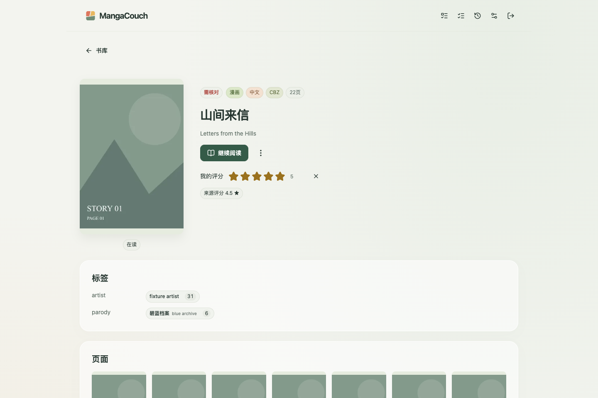
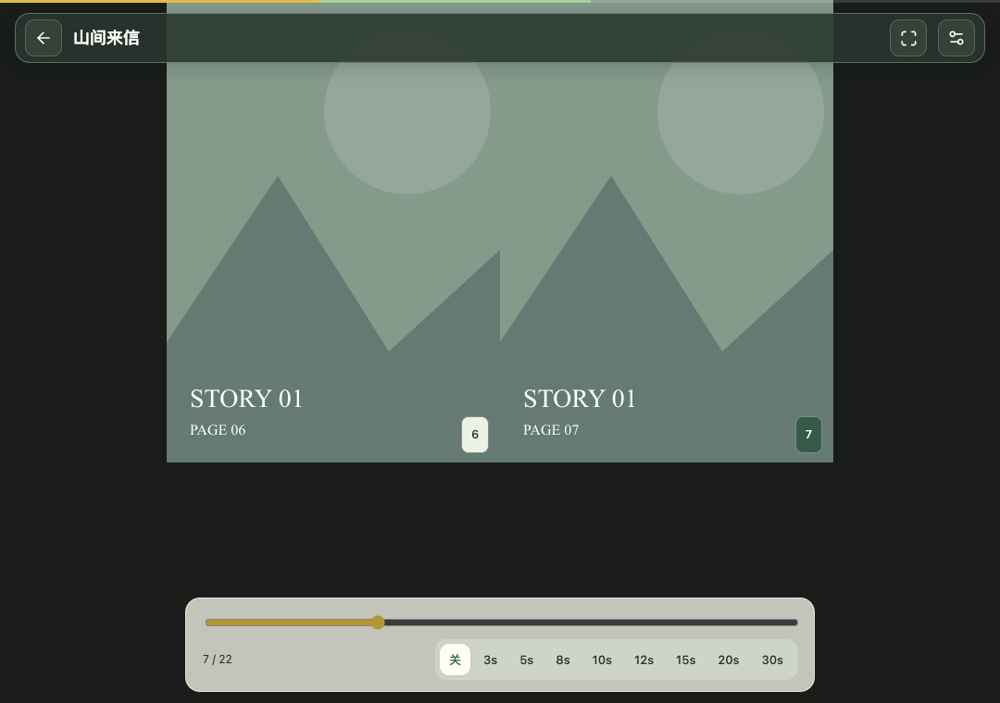
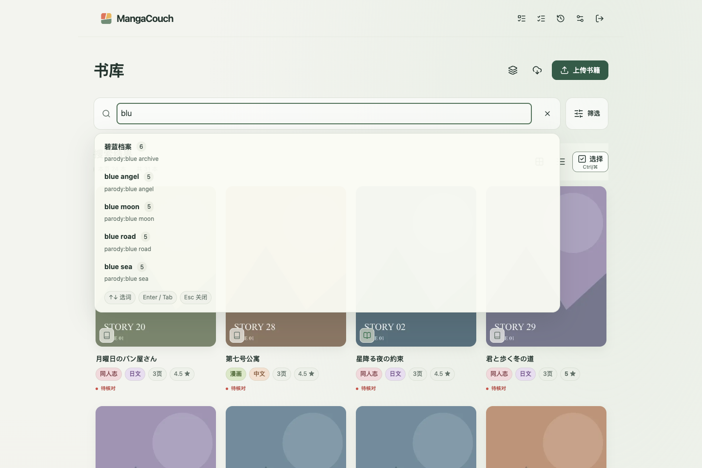
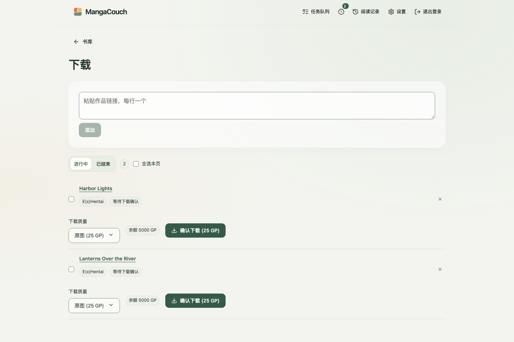
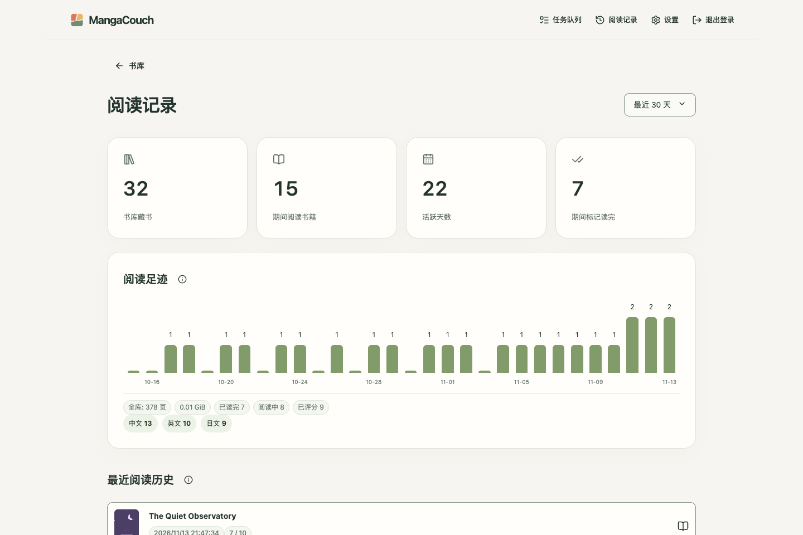
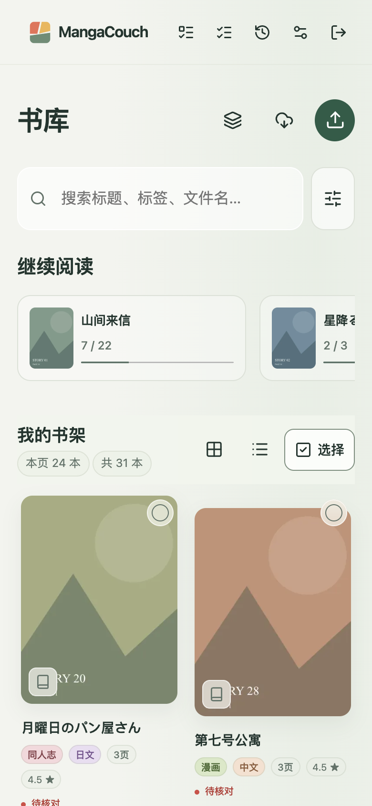

# MangaCouch

[English](README.md) | **简体中文**

自托管的个人漫画书库：导入 CBZ/ZIP 和 PDF，在任何设备的浏览器里阅读，也能通过 OPDS 或兼容 Komga 的接口接入常用的阅读器 App。


## 特性

- **书库**：网页上传，或把文件放进 `import/` 文件夹扫描导入；支持 GIF、JPEG、WebP、PNG 页面。
- **查找**：标签自动补全并显示中文译名；按类别、语言、来源、阅读状态和评分筛选；**静态**合集手动收录，**动态**合集按搜索条件自动收录。
- **阅读器**：单页、双页、竖向滚动；左右翻页方向可选；自动翻页和缩略图预览进度条。
- **多端同步**：阅读进度和评分跨设备同步，另有阅读统计。
- **元数据整理**：待核对队列、分别显示索引和比较进度的逐页重复检测，每本书旁边生成 `.mangacouch.json` 元数据文件。
- **下载**：在网页或 Chrome 扩展里加入 E(x)Hentai 作品，可选择下载画质；付费存档须确认后才会购买。E-Hentai 请求按站点的用量额度自动调节速度，遇到封禁或限流会自动暂停。
- **外部阅读器**：OPDS 1.2 和 Komga API 子集，API key 按权限分级。
- **安全稳妥**：口令登录、导入中断安全清理、移除记录可在七天内恢复（勾选“删除文件”则会直接删除文件）、一键备份。
- 中英文界面，浅色/深色主题，自适应书架布局，合集草稿离开保护。

## 截图

<table>
  <tr>
    <td></td>
    <td></td>
  </tr>
  <tr>
    <td></td>
    <td></td>
  </tr>
  <tr>
    <td></td>
    <td></td>
  </tr>
</table>

<p align="center"></p>

截图使用虚构的示例书库，书名混合中文、日文和英文；重新生成的方法见[开发文档](docs/development.md#screenshots)。

## 快速开始

Docker Compose（拉取 `ghcr.io/mangacouch/mangacouch`；compose 文件和 `.env.example` 在本仓库中）：

```sh
git clone https://github.com/MangaCouch/MangaCouch.git && cd MangaCouch
cp .env.example .env            # 设置 MANGACOUCH_ORIGIN、UID、GID
mkdir -p deploy/state deploy/books
docker compose --env-file .env -f deploy/compose.yaml run --rm mangacouch init
docker compose --env-file .env -f deploy/compose.yaml run --rm mangacouch auth-init
docker compose --env-file .env -f deploy/compose.yaml up -d
```

从源码运行：需要 Python 3.12–3.15、[uv](https://docs.astral.sh/uv/) 和 Node.js 26 或更新版本，支持 Apple Silicon macOS、Windows x64、glibc Linux x64/ARM64，无需编译器。网页界面不随仓库提交，需要先用 Node.js 构建：

```sh
uv sync --locked
npm --prefix web ci && npm --prefix web run build
mkdir -p data/state data/books
uv run mangacouch --db data/state/library.sqlite --root data/books init
uv run mangacouch --db data/state/library.sqlite auth-init
uv run mangacouch --db data/state/library.sqlite serve --origin http://localhost:8780
```

然后打开 `http://localhost:8780`，用设置的口令登录。

不想装 Python：从 [Releases](https://github.com/MangaCouch/MangaCouch/releases) 下载对应平台的压缩包，用同样的参数运行 `mangacouch/mangacouch`，详见[安装文档](docs/install.md#standalone-executable)。在 Windows 和 macOS 上，不带参数启动同一个程序即为托盘 / 菜单栏启动器，无需终端即可完成初始设置并运行书库，详见[桌面启动器](docs/install.md#desktop-launcher-windows-and-macos)。

## 文档（英文）

- [安装](docs/install.md)：独立程序、桌面启动器、Docker、源码、wheel、升级、局域网与 HTTPS、忘记口令、命令行速查
- [书库、存储与恢复](docs/library.md)：导入、目录布局、在线来源、格式与上限、缓存、备份与恢复
- [客户端与集成](docs/clients.md)：API key、OPDS、Komga、浏览器扩展
- [开发](docs/development.md)：检查、测试、截图与发布

## 许可证

[MIT](LICENSE)
